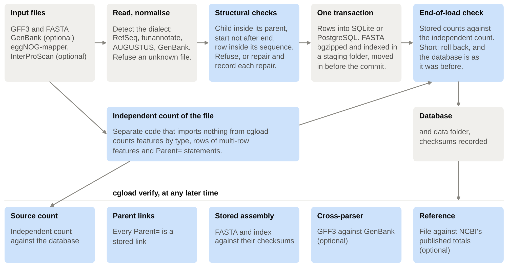
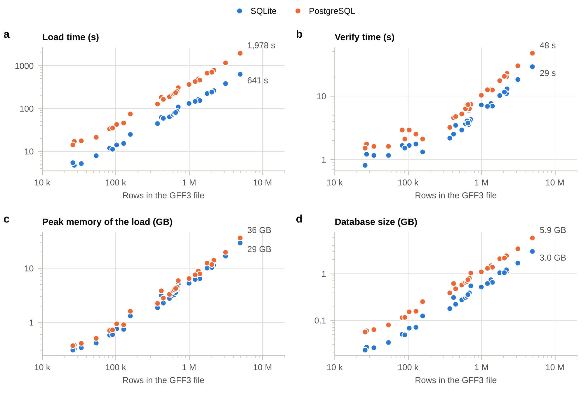
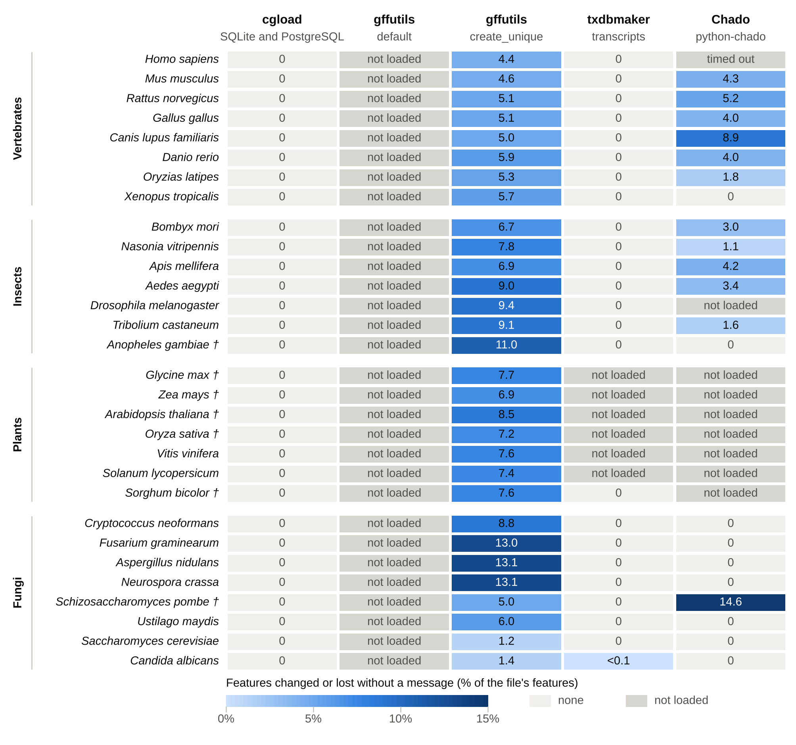
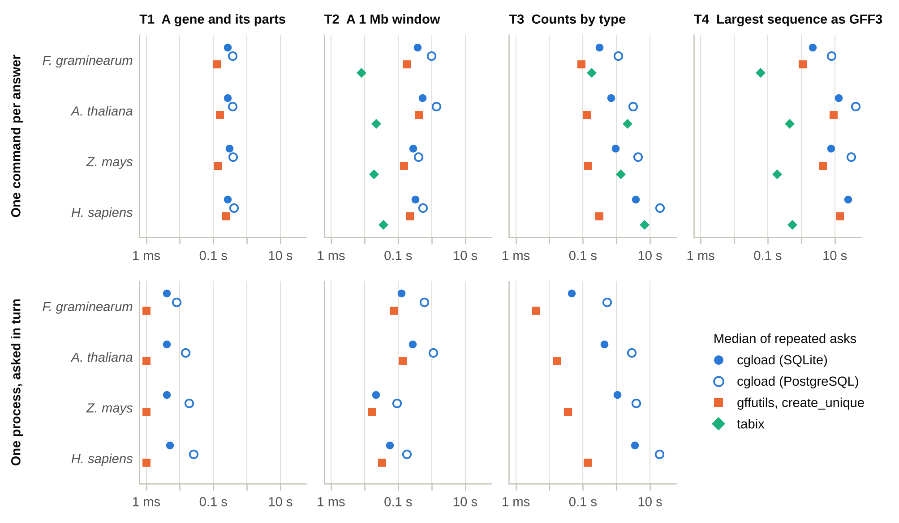

<!--
Source of the manuscript. paper/build.py makes the Word file: it puts in the
tables that paper/figures.py made from paper/data/benchmark-run-2.2, numbers
the citations (written here by key, as [@key]) in order of first citation, and
shows the notes to the authors. Do not type a result number into a table by
hand; change the data or the script.
-->

<!-- AUTHORS: This draft was written with a large language model, and the
last section says so, as GigaScience's policy requires. The policy allows this
when it is disclosed, and holds every author fully responsible for the text.
Read every sentence against what you know before submitting. Places that only
you can complete are marked like this one. -->

**Aditya Upadhyay**^1,2^, **Arijit Panda**^3^ and **Sucheta Tripathy**^1,2,\*^

^1^ Structural Biology and Bioinformatics Division, CSIR-Indian Institute of Chemical Biology, Jadavpur, Kolkata 700032, India.
^2^ Academy of Scientific and Innovative Research (AcSIR), Ghaziabad 201002, India.
^3^ Department of Quantitative Health Sciences, Mayo Clinic, Rochester, MN 55905, USA.

\* Corresponding author.

<!-- AUTHORS: the journal asks for the e-mail address of every author here, and
ORCID iDs where you have them. Mark the corresponding author's address. -->

# Abstract

**Background:** Genome annotations in GFF3 format are often loaded into a
database before use. A loader can drop or alter features as it reads, and the
database still answers queries, so the loss goes unseen.

**Findings:** The Python tool cgload loads an assembly and its annotation
into SQLite or PostgreSQL in one transaction, compares what it
stored with a count of the input made by separate code, and rolls back a load
that falls short. We tested it and three other loaders on 30 RefSeq genomes
(28.2 million GFF3 rows, 18.0 million features) under a protocol fixed beforehand,
comparing each result with a reference reading that shares no
code with any loader. cgload stored 18,017,606 features unchanged, declared the
12 it repaired and lost none. gffutils by default refuses a file that repeats
an ID, as all 30 do, and with `create_unique` it stored 1,072,125 multi-row
features as separate records without a message. txdbmaker stopped on six plant
genomes, three of them at rows that cgload also refuses by default.
python-chado did not finish nine genomes and, in the other 21, lost 5.0% of
the features, four in five without a message. cgload noticed all 57 planted
faults within its checks and, as predicted, none of 24 that changed values but
kept every count. Loading the human annotation took 641 s and 29.5 GB of
memory.

**Conclusions:** A count of the input by independent code catches silent loss
at load time. cgload is open source (MIT license):
https://github.com/computational-genomics-lab/cgload.

**Keywords:** genome annotation; GFF3; relational database; data integrity; benchmarking; RefSeq

# Findings

## Background

Genome projects publish their annotations as GFF3 files [@gff3], such as those
of NCBI RefSeq [@refseq]. To ask questions of an annotation, many groups first
load it into a database. gffutils builds an SQLite database from a GFF3 file
[@gffutils]. Chado is a relational schema for genome data, used by many
organism databases [@chado] and filled by loaders such as the one in Tripal
[@tripal]. Bioconductor's txdbmaker builds a TxDb, a database of transcripts
for analysis in R [@granges; @txdbmaker], and data warehouses such as InterMine
combine annotations from many sources [@intermine].

A loader can drop or change features while it reads a file. GFF3 lets one
feature be written on several rows that share an ID, which is how RefSeq writes
coding sequences, so a reader that expects one row per feature, or one ID per
row, gets these features wrong. Some features cross the origin of a circular
sequence, some genes are trans-spliced from distant parts of an organelle
genome, and some strands are unknown. We counted these in the 30 RefSeq
annotations used here (see "What the files contain"). Rows that break a GFF3
rule outright are rare. Rows that follow a documented convention, or carry an
attribute that documents an exception, are more common, and a loader has to
take them as written. A loader can finish without a message and still leave
such features out, or store them in another form. The database then answers
queries, and nothing downstream can see what is missing.

Large resources test their databases before each release. InterMine's
acceptance tests are SQL queries with expected answers, such as a minimum
number of GO annotations [@intermine-tests]. Ensembl's datachecks test row
counts and metadata in each database before it is handed over [@ensembl;
@datacheck]. Curators write these tests for a resource they know, and the tests
compare the built database with their expectations. As documented, neither
compares a database with an independent reading of the files it was built
from. Recent tools aim at speed: gffbase stores GFF3 and GTF files in DuckDB
and validates a sample of records [@gffbase], and GFFx indexes GFF files for
fast extraction and assumes well-formed input [@gffx]. Toolkits such as
GenomeTools [@genometools] and AGAT [@agat] check or repair a file before it is
loaded, and do not see what a loader then stores.

We wrote cgload to make that check part of every load. It reads the input file
twice, once to load it and once, with separate code, to count it, and it keeps
the load only if the database holds what the count says. We then asked how
cgload and other loaders behave on real files.

## Implementation

cgload is a Python package (3.11 or later) with three runtime dependencies:
SQLAlchemy, pyfaidx and click. It stores a genome in a relational database
through SQLAlchemy, on SQLite or PostgreSQL. SQLAlchemy also reaches MySQL, but
cgload has no test on MySQL, and we do not claim it works there. The schema has
11 tables. A feature written on several rows keeps one stored row per segment,
each with its own attributes, and the rows of a feature share its ID. Each
stored row refers to its parent, so a feature that names more than one parent
cannot be stored, and cgload refuses a file that has one. The assembly FASTA is
compressed with bgzip and indexed [@tabix; @htslib] in a data folder beside the
database, and the database records its checksum. Functional annotation from
eggNOG-mapper [@eggnog] and InterProScan [@interproscan] becomes one row per GO
term, KEGG ortholog, Pfam domain or EC number.

Annotation pipelines write GFF3 differently. cgload reads RefSeq GFF3, the GFF3
of funannotate [@funannotate] and AUGUSTUS [@augustus], and GenBank flat files.
Each dialect is a declared profile that says which feature types it provides
and how the file identifies itself, and a file that matches no profile is
refused with the names of the profiles that were tried. Every dialect is
normalised to one representation before anything reaches the database.

Before it writes anything, cgload checks the structure of the file. A feature
must lie inside the span of the parent that claims it, a start must not exceed
its end, and a row must not run past the end of its sequence unless the
sequence is circular. By default a file that breaks these rules is refused, and
the message names each offending feature and the option that repairs it. With
`--repair-envelopes`, cgload recomputes each parent's span from its children,
leaves first, and writes every change to the load's manifest. A disagreement
that exists only across the origin of a circular sequence is stored as written.

The load is one database transaction. The data folder is prepared in a staging
directory and renamed into place just before the commit. At the end of the
load, cgload counts what it stored and compares the counts with an independent
count of the file. If any count is short, it rolls the transaction back. A load
therefore stores the whole file or leaves the database as it was.

The command `cgload verify` repeats these checks at any later time, in tiers
(Figure 1). The source-count tier counts the file again with code that imports
nothing from cgload: features of each type, rows of each feature written on
several rows, and parent statements. These counts must equal the database's.
The parent-edge tier requires every `Parent=` statement in the file to be a
stored link. The stored-assembly tier compares the FASTA and its index with the
checksums taken at load. Two optional tiers compare the file with other
descriptions of the same assembly: the GenBank file (cross-parser tier) and
the totals NCBI publishes for the annotation release (reference tier). A tier
that cannot run says so and gives the reason. `verify` exits with status 2 when
a tier fails and 0 otherwise.

These checks establish completeness: every feature, every row and every stated
parent link is present, and nothing was invented. They do not establish that a
value is right. A wrong strand or a shifted coordinate keeps every count the
same, so these checks cannot see it.

Other commands read the database. `cgload query` returns features by ID, with
everything below them if asked, by region or by functional annotation term,
`cgload stats` counts features, and `cgload export` writes an assembly's
annotation back out as GFF3. Much of the code, its tests and its documentation
were written with a large language model, under the authors' direction
[@claude]; the last section of this paper gives the details.

**Figure 1. How cgload loads and verifies an annotation.** Grey boxes load and
blue boxes check. A separate reader counts the input file with code that
imports nothing from cgload. At the end of the load its counts decide whether
the transaction is committed or rolled back, and `cgload verify` compares them
with the database again at any later time.

Alt text: Flow diagram. Top row, left to right: input files; read and
normalise; structural checks; one transaction; end-of-load check. Below, an
independent count of the file feeds the end-of-load check, which commits to
the database or rolls back. Bottom row: the five tiers of cgload verify.

## Testing

The benchmark follows a protocol (`benchmark/PROTOCOL.md` in the repository)
that we committed and tagged `benchmark-protocol-v1` on 16 October 2026, with
every script it names, five days before the first run. The protocol states the
questions, the genomes, the software, the hardware, the definitions and, for
every planted fault, the outcome expected from what cgload claims to check.
Benchmarks written by a tool's own authors tend to favour that tool [@weber;
@buchka], and fixing these things first was our way to limit that. A change
made after the first run is listed in the protocol with its date and reason,
and every measurement it affects was repeated (Methods, "Changes after the
first run"). The protocol asks seven questions:

- Q1. Does cgload load and verify all 30 genomes, on SQLite and on PostgreSQL,
  and at what cost in time, memory and disk?
- Q2. Does what cgload stores match the input, feature by feature?
- Q3. What do other loaders keep, change or lose from the same files, and do
  they say so?
- Q4. Which damage to a loaded genome, or inside the parser, does cgload notice?
- Q5. What does an interrupted load leave behind?
- Q6. How long does a user wait for everyday answers?
- Q7. Do cgload's structural checks agree with an independent census of the
  same files?

It also listed an eighth question, a case study on one of our own genomes with
its functional annotation. No such genome was available, and the question was
dropped before any of it was run.

### What the files contain

The 30 annotations hold 28,211,625 GFF3 rows on 23,793 sequences, of which 33
are organellar. Writing one feature on several rows is not an edge case:
10,194,007 IDs appear on more than one row. Exons placed directly under a
pseudogene, which some readers do not expect, occur 91,009 times in 20 of the
30 files. No file had a dangling parent statement, an ID used for two different
features, or a non-numeric coordinate.

The census flagged 110 findings on 102 distinct rows, about 4 per million. Most
are things a loader must accept: 67 rows lie outside the parent that claims
them, 63 of them in genes whose own attributes state trans-splicing or RNA
editing, and 31 rows carry the strand `?`, which GFF3 allows. Of the rest, 9
rows run past the end of their sequence and 3 have a start after their end.
Sixteen findings in 5 files carry no documented exception: 12 on plant
organelles, and 4 in *Schizosaccharomyces pombe*, the only ones outside an
organelle, where a gene's span leaves out part of a child. A further 9 rows
cross the origin of a circular sequence, which the census counts as a
convention. So the files are clean, and nearly everything that looks wrong at
first reading is a documented convention that a loader has to store as written.

### cgload loads and verifies all 30 genomes (Q1, Q2)

cgload loaded all 30 genomes on both SQLite and PostgreSQL (Supplementary Table
S1). Twenty-three loaded as they are. Seven were refused at first, each over
features lying outside the parent that claims them, or a start after its end,
and loaded with `--repair-envelopes`, which repaired 12 features in all and
listed each one. After every one of the 60 loads, `verify` passed the
source-count, parent-edge and stored-assembly tiers, and for the eight fungi
the cross-parser tier as well.

The round trip kept 18,017,606 of the 18,017,618 features. The other 12 were
the repaired ones, changed in their spans as the manifest declared. No feature
was lost, none changed without a declaration, and all 16,566,107 parent links
came back. SQLite and PostgreSQL gave the same result for every genome.

Load time, memory and size grew in proportion to the number of rows (Figure 2).
On SQLite, cgload loaded a median 7,961 rows per second; the quickest load, *S.
cerevisiae*, took 4.8 s and human took 641 s. PostgreSQL was about three times
slower (median 2,700 rows per second; human 1,978 s). `verify` took 0.8 to 29 s
on SQLite and 1.5 to 48 s on PostgreSQL. The load held about 6 KB of memory per
row (median 5.7 KB on SQLite and 6.9 KB on PostgreSQL), so human needed 29.5 GB
and 36.4 GB at its peak. Its database took 3.0 GB on SQLite and 5.9 GB on
PostgreSQL, and its data folder 3.2 GB.

**Figure 2. The cost of loading the 30 genomes with cgload.** Against the
number of GFF3 rows: (a) load time, (b) time of `cgload verify`, (c) peak
memory of the load and (d) size of the database. Each point is one genome on
one database system. Both axes are logarithmic. The values for human, the
largest genome, are labelled.

Alt text: Four scatter plots with logarithmic axes. In each, 30 points for
SQLite and 30 for PostgreSQL rise in a straight band from about 26,000 to 4.9
million rows. PostgreSQL lies above SQLite in load time, verify time and
database size, and close to it in peak memory.

### What other loaders keep, change and lose (Q3)

Table 1 sums up the results and Figure 3 shows them per genome.

**Table 1. What each loader kept, changed and lost.**

<!-- include tables/table1_loaders.md -->

Counts are features, except for txdbmaker, which holds transcripts, and cover
the genomes each loader loaded. cgload gave the same result on SQLite and on
PostgreSQL, and loaded 7 of its 30 genomes with `--repair-envelopes`. A change
is declared when the loader recorded it, announced when its output names the
feature or its type, and silent otherwise. The nine genomes python-chado did
not load hold 7,244,078 features, and the six txdbmaker did not load are all
plants; neither is counted in its column.

gffutils with its default settings stops at the first ID written on two rows
(`ValueError: Duplicate ID`), the documented behaviour of its default merge
strategy, and every one of the 30 files has such IDs. With `create_unique` it
loaded all 30 and lost no feature, but stored each of the 1,072,125 features
written on several rows (6.0% of all features) as separate records, the second
and later ones under new IDs. A query for such a feature by its ID returns one
part. The share ranged from 1.2% in *Saccharomyces cerevisiae* to 13.1% in
*Aspergillus nidulans* and *Neurospora crassa*. gffutils printed nothing about
it. It changed no attribute and kept every parent link.

txdbmaker stopped on six of the seven plant genomes. On maize, *Arabidopsis
thaliana* and soybean it stopped at a row whose end precedes its start, an
inverted mitochondrial *nad1* transcript in each. The census classes these
three rows as errors in the files, and cgload refuses the same three files at
the same rows unless `--repair-envelopes` is given. On rice, tomato and
grapevine txdbmaker stopped while building the TxDb, reporting 2 exons in each
file linked to transcripts it could not find. On the 24 genomes it loaded, it
kept 1,169,686 of 1,169,826 transcripts. It changed 104 and dropped 36, and its
messages named all but 3 of the changes. Another 647,583 features have types
that a TxDb does not model.

python-chado stopped with an error about a feature's location on all seven
plant genomes and on *Drosophila melanogaster*, each time at a trans-spliced
gene: organelle genes in the plants and CG32491 in the fly. The human load
reached its 24-hour limit. None of these nine loads stored anything. In the 21
loads that finished, python-chado lost 540,255 of 10,773,540 features (5.0%),
of three kinds. It dropped all 109,181 features of type lnc_RNA, a type the
Sequence Ontology now names lncRNA (SO:0001877) [@so], and its log named the
type. It dropped their 430,836 exons without a message. It also dropped 238
long terminal repeats that the *S. pombe* file writes in capitals, and named
that type too. So four in five of its losses were silent, from none in 9
genomes to 14.6% of the features in *S. pombe* (Figure 3). These loads kept
9,627,024 of 10,167,041 parent links, and python-chado added 670,102
polypeptide features that the files do not contain.

**Figure 3. Features changed or lost without a message, per genome and
loader.** Each cell gives the percentage of the genome's features (for
txdbmaker, transcripts) that the loader changed or lost without a message.
Dark grey cells mark genomes a loader did not load. cgload's results were
identical on SQLite and PostgreSQL. † cgload loaded these genomes with
`--repair-envelopes` and declared every repair.

Alt text: Grid of 30 genomes in four groups (vertebrates, insects, plants,
fungi) by five loader columns. The cgload column is 0 throughout. gffutils
default is "not loaded" throughout. gffutils create_unique runs from 1.2 to
13.1 percent. txdbmaker is 0 except six plants not loaded. Chado runs from 0
to 14.6 percent, with nine genomes not loaded.

The hard cases show where the alterations come from (Table 2). gffutils split
every feature written on several rows, and these include the features of most
other hard cases. txdbmaker's changes and losses fell on rows that overlap, on
unknown strands and on trans-spliced and organelle transcripts, and its
messages named them. In the loads that finished, python-chado kept every
hard-case feature; the genomes with trans-spliced genes or unknown strands were
the ones on which it stopped. cgload kept every hard-case feature or declared
its repair.

**Table 2. Hard cases and what each loader altered.**

<!-- include tables/table2_cases.md -->

For each hard case the protocol defines: the number of features in the 30
files, what each loader altered (changed or lost) and how many of those
alterations were silent. A feature can be in several cases, and nearly every
feature has an attribute with several values. Chado's counts cover its 21
finished loads and txdbmaker's the transcripts of the 24 genomes it loaded,
each with its own total; a dash means the case does not occur there.

Table 2 counts features, and the census above counts rows, so their numbers
differ for the same cases. The census reads rows as they are written. The
reference reader behind Table 2 first joins the rows of each feature and puts
each row's coordinates in order. The 31 rows with strand `?` belong to 30
features, because one gene is written on two rows. The 67 rows outside their
parent belong to 47 features, since coding sequences written on several rows
are flagged row by row. The reference reader counts 46. The two counts need not
agree, because the census compares each row with its parent as written, and the
reference reader compares whole features after putting coordinates in order:
it finds 8 such features in maize where the census finds 10, and 13 in *A.
thaliana* where the census finds 12. All 9 rows that the census counts as past the end
of a sequence lie on circular organelle sequences. The census keeps them apart
from its 9 origin-crossing rows because they do not have the form of that
convention. The reference reader has one rule for both: on a circular
sequence, a feature that begins before the end of the sequence and runs past
it crosses the origin, and one written wholly beyond the end is past the end.
Its 14 origin-crossing features are therefore the 9 that the census counts as
such, the 3 transcripts written with start after end, and 2 coding sequences
with one or two rows written beyond the end. Its 3 features past the end are 3
exons written wholly beyond it.

### Faults (Q4)

All 81 fault trials (27 faults in 3 genomes) ended as the protocol predicted
(Table 3, Additional file 2). `verify` detected every fault that deleted,
duplicated or retyped a feature, removed a parent link, or damaged or moved
the stored assembly. Every fault planted in the parser that dropped, added or
retyped a row stopped the load: one by its structural check (a child whose
parent was dropped), the others by the end-of-load counts, which rolled the
load back. As stated in advance, cgload did not notice the eight faults that
change only a value: a flipped strand, a shifted start, a renamed feature, a
parent pointed elsewhere, a deleted attribute, and in the parser a flipped
strand, a shifted start and two swapped IDs.

One fault needs a caveat. When the input file was edited after the load
(F16), `verify` named the file, said it had changed since the load, and skipped
the source count. It still exited with status 0, because a skipped tier is not
a failure. A script that reads only the exit status would miss this edit.

**Table 3. Planted faults, grouped by what they do.**

<!-- include tables/table3_faults.md -->

Each fault was planted in *Fusarium graminearum*, *A. thaliana* and human.
"Caught by" names the check that reported it.

### Interrupted loads (Q5)

Every killed cgload load left the database as it was (Table 4). After the 20
killed new loads the database was empty, and the same load then succeeded each
time. After the 20 killed `--force` reloads, the earlier load was intact and
passed `verify`. In 28 of the 40 trials, cgload left files on disk outside any
stored assembly, from its staging folder or from the folder a `--force` reload
sets aside (up to 124 MB). After a killed new load, the next load did not
remove them. We list this among cgload's known limitations.

python-chado commits only at the end, so its five killed loads left an empty
database. gffutils left a database file after all 20 kills, and gffutils could
open none of them. Seventeen were empty. Three held every record of a complete
load, because the kill came after the last insert but before gffutils wrote the
metadata it needs to open the file.

**Table 4. What a killed load left behind.**

<!-- include tables/table4_kills.md -->

Each kill came at a random time between 5% and 95% of an uninterrupted load.

### Query waits (Q6)

cgload answered everyday questions more slowly than gffutils (Figure 4,
Additional file 3). One
gene with its parts took 0.26 to 0.30 s as a command on SQLite and 0.37 to 0.41
s on PostgreSQL, against 0.13 to 0.24 s for gffutils. Most of that time is
the start of a new Python process: asked from one running process, the same
lookup took 4 to 5 ms on SQLite, 8 to 25 ms on PostgreSQL and 1 ms or less in
gffutils. For a 1 Mb window, tabix answered in 8 to 36 ms, at least six times
faster than any of the databases asked as a command; from a running process
gffutils answered about as fast as tabix on maize (17 ms). Counting features
by type took cgload longest: 3.8 s for human on SQLite and 19.5 s on
PostgreSQL, against 0.3 s for gffutils. The two answers differ, since gffutils
counts records and cgload counts features.

For T4, writing out every feature on one sequence, the protocol takes the
sequence with the most features in each genome and two others drawn at random
from those with at least 1,000 features. In human the two drawn were small
scaffolds, so a median over its three sequences would hide the cost. Figure 4
therefore shows the largest sequence of each genome, and Additional file 4
all twelve. Writing human chromosome 1 (437,536 rows) took 25.0 s on SQLite,
88.6 s on PostgreSQL, 14.4 s with gffutils and 0.5 s with tabix.

**Figure 4. Time to answer four everyday tasks on four genomes.** Median time
of repeated asks, on genomes from 0.1 to 4.9 million rows. Top: one new process
per answer, as a user typing a command waits. Bottom: one process asking T1 to
T3 in turn, as a script waits. T4 is shown for the largest sequence of each
genome. tabix answers T2 and T4 from cgload's compressed annotation, and T3 by
a full scan. Medians at or under 1 ms, the resolution of the clock, are drawn
at 1 ms. The page cache was not dropped.

Alt text: Seven dot plots on a logarithmic time axis from 1 millisecond to 100
seconds, four genomes in each. In every panel gffutils answers faster than
cgload on SQLite, and cgload on SQLite faster than cgload on PostgreSQL. tabix
is fastest for windows and whole sequences, and slower than gffutils for
counts. From one running process, gene lookups take milliseconds.

### cgload's checks against the census (Q7)

The census flagged 110 findings on 102 distinct rows, and counted 9 more that
cross the origin of a circular sequence. cgload accepts rows of that last kind,
as GFF3 allows. On the 102 rows (Table 5), both checkers accepted the 23 rows
whose only finding is the strand `?`, and both objected to the 13 the census
classed as errors or unexplained, though cgload loaded 6 of these with a
warning. For the other 66 rows, nearly all in trans-spliced organelle genes,
cgload refused the file unless `--repair-envelopes` was given. With it, cgload
repaired 12 features. Sixty-three of the flagged rows are children of those 12
features and were accepted once their parent was repaired, up to 10 rows under
one transcript; 8 flagged rows are themselves among the repaired features. No
row that the census classed as an error was accepted by cgload without comment.
cgload objected to 8 features that the census did not flag. Each is a gene or
pseudogene whose span leaves out a child that the census did flag, so the two
found the same 11 parent and child pairs from opposite ends.

**Table 5. cgload's structural checks and the census on the same rows.**

<!-- include tables/table5_agreement.md -->

Rows are those the census listed in the 30 files, by the census's classes.

## Discussion

Each of the other three loaders stored some features in another form, or not
at all, without a message: gffutils 1,072,125 features, python-chado 430,836
in its finished loads and txdbmaker 3 transcripts. The causes differ. RefSeq
writes coding sequences on several rows that share an ID, as GFF3 allows.
gffutils refuses such files by default, which is a safe choice, and with the
setting its documentation offers for them it stores each row as a feature of
its own. A user who then asks for a coding sequence by its ID gets one segment
of it, and nothing in the database says that the rest exists under other
names. python-chado stopped at trans-spliced genes, and where it finished, it
dropped a whole class of transcripts over the spelling of a type name and
their exons along with them. txdbmaker was the most careful of the three: it
stopped on the files it could not model, three of them files that cgload also
refuses by default, and it named nearly every transcript it changed or dropped.

The other tools do some things better. gffutils loaded the human annotation
with 140 MB of memory, where cgload needed 29.5 GB, and it answered lookups
faster. Each tool makes a choice about rows that share an ID, and the trouble
is that the choice is silent. A benchmark of this kind can only be fair to each
tool's documented use, and we ran each as its documentation describes; other
settings, or other Chado loaders, may do better.

cgload adds a check that does not trust its own loader. The source count
is made by code that shares nothing with cgload's parser, so an error in the
parser cannot hide itself in the check. The faults show both sides of this.
Every fault that changed a count was caught, including those planted inside the
parser, which a check built from the same parser could not see. Every fault
that changed only a value went unnoticed, as the protocol predicted. A user
who needs values checked has to compare them with the file, as our round trip
does, and that comparison is not part of `cgload verify`.

Refusing by default has a cost. Seven of the 30 RefSeq files were refused
until `--repair-envelopes` was given, over rows that carry a documented
exception or follow a documented convention. We chose to stop and name the
features, and to repair only on request, because a parent span that does not
contain its children is contradictory whatever its cause. A user who wants
every RefSeq file to load without a flag will find this strict.

### Limitations

cgload was corrected on the same 30 genomes it is measured on. Fourteen of its
recorded decisions (D-095 to D-108 in the repository) fixed problems that these
files exposed in the first run, the preflights and the second run. We did not
run a second panel of genomes that cgload had never seen, so its results on
other files, or on later RefSeq releases, may be worse. The planted faults and
the other loaders were not tuned in this way.

All 30 genomes are RefSeq. cgload's profiles for funannotate and AUGUSTUS
files, and its loading of functional annotation, are covered by its tests but
were not part of this benchmark. MySQL was not tested at all. cgload refuses a
feature that names more than one parent, which GFF3 allows and RefSeq does not
use.

We did not benchmark gffbase or GFFx. Neither was in the protocol: we found
them in a literature search after the runs were complete. gffbase in
particular treats a multi-row feature as one feature, and belongs in any
repeat of this benchmark.

The comparison is not symmetric in one respect. cgload's result was read from
the GFF3 file that `cgload export` writes, while gffutils' and Chado's were
read from their databases with SQL. Our numbers therefore test cgload's load
and export together and cannot tell the two apart.

cgload holds the whole file in memory during a load, about 6 KB per row. A
human-sized annotation needs 30 to 37 GB, which rules out a laptop. Counting
features on PostgreSQL took 19.5 s for human, and gene lookups as commands
took about a quarter of a second, mostly to start Python. A killed load leaves
its staging files. `verify` exits 0 when it skips the source count because the
input file has changed; this is unchanged in version 0.2.1.

The benchmark was written by cgload's authors, and its protocol was registered
as a tagged commit in our own public repository, not in an independent
registry. We tried to limit the bias that follows [@weber; @buchka] by fixing
the protocol first, by using a reference reader that shares no code with any
loader, and by reporting our own errors. Three errors in our scripts made other
loaders look worse until we found and fixed them (Methods). Chado stands here
for python-chado alone. The other loaders ran several at a time, so their load
times are indicative only, and we draw no conclusion from them.

## Conclusion

A database built from a GFF3 file deserves the same check as any other copy of
data: does it hold what the file holds? cgload answers that question after every
load, with code that does not share the loader's assumptions, and stops when the
answer is no. On 30 RefSeq genomes it kept every feature, declared its 12
repairs and noticed every fault that changed a count. The protocol, scripts,
results and figures of this benchmark are public, so the same questions can be
put to other loaders and other files.

# Methods

## Genomes and input files

The panel is 30 RefSeq genomes: 8 vertebrates, 7 insects, 7 plants and 8 fungi
(Additional file 1). They were chosen to span clades, assembly sizes and
annotation ages, and the list was fixed in a tagged commit (`survey-panel-v1`,
6 October 2026) before any of them was read. Together the annotations have
28,211,625 GFF3 rows, 18,017,618 features and 16,566,107 stated parent links.
The smallest is *Candida albicans* (25,889 rows) and the largest is human
(4,932,571 rows, 3,203,237 features). Every file is identified by its MD5,
which the benchmark checks before each run. One download, medaka, had been cut
short, and this check found it; the file was fetched again and every count of
it redone (`survey/results/CORRECTIONS.md`). The assembly FASTA files, and the
GenBank files of the eight fungi, came from NCBI Datasets [@datasets].

## Census of the files

Before the benchmark we counted what the 30 files contain, with a script
(`survey/cgsurvey.py`) that reads a GFF3 file as text, line by line, with the
Python standard library only. It shares no code with cgload and is not
installed with it. For each file it counts the rows, the parent statements, the
sequences and the IDs written on more than one row, and it flags four kinds of
row: a feature outside the parent that claims it, a start after its end, a row
past the end of its sequence, and a strand written `?`. It counts separately
the rows that follow two documented conventions, an exon placed directly under
a pseudogene and a row that crosses the origin of a circular sequence, which
GFF3 and NCBI both write by letting the end run past the sequence length. For
every flagged row it records the raw GFF3 line and any attribute that documents
an exception, such as `exception=trans-splicing` or `partial=true`, so that
each can be read by hand.

We then classed every flagged row into one of four: (A) valid GFF3 that a
loader must accept, (B) a documented convention or an exception the file itself
states, (C) an error in the file, and (D) a finding no convention explains.
Classes A and B are what a loader has to handle; C and D are what a file ought
not to contain.

## Reference reading and comparison

A reference reader (`benchmark/truth.py`) reads each GFF3 file with the Python
standard library only and shares no code with cgload or with any other loader.
It follows the GFF3 specification [@gff3]: rows that share an ID form one
feature, a row without an ID is a feature of its own, and `Parent` names the
parents. For each feature it records the sequence, the type, the strand and
span of every row, the parents, and a digest of all other attributes (keys and
values sorted, escapes decoded). White space at either end of a tag=value pair
is not part of it.

A loader's result is reduced to the same record and compared with the
reference feature by feature. For cgload, the record is read from the GFF3 file
that `cgload export` writes from the database, so the comparison covers the
round trip. For gffutils and Chado it is read from their databases with SQL. A
feature is kept when the loader holds it once and every compared field equals
the file's. It is changed when the loader holds it with a field that differs,
or holds it as several records. It is lost when the loader does not hold it. A
change that the loader reported in its own record is declared (cgload lists
each repair in its manifest). A change or loss is announced when the loader's
output names the feature, or names its type on a line saying it was skipped,
dropped, ignored, rejected or unknown. Otherwise it is silent.

The fields compared are sequence, type, strands, spans, parents and attributes
for cgload and gffutils. For Chado the attributes are left out, because
python-chado spreads them over several tables. txdbmaker holds transcripts, not
features, so it is compared per transcript: sequence, strand, span, gene, exon
spans and CDS spans. Transcripts are paired by the name txdbmaker gives them,
or failing that by span, and features of types txdbmaker does not model are
counted apart, not as lost. A feature whose rows carry different attributes is
compared row by row. Each feature is also placed in the hard cases the
protocol defines, such as a feature written on several rows, a trans-spliced
feature, a feature on an organelle or one that crosses the origin. Twelve of
these cases occur in the 30 files (Table 2).

## Loaders and versions

Table 6 lists the versions used. gffutils was run twice: with its default merge
strategy, which is what a user who changes nothing gets, and with
`create_unique`, the documented way to load a file whose rows repeat an ID
[@gffutils]. txdbmaker's `makeTxDbFromGFF` was told which sequences are
circular [@txdbmaker]. For Chado we used python-chado [@pychado], the
`load_gff` command used by Galaxy Genome Annotation, which reads GFF3 with
Biopython [@biopython], into a new Chado database with the Sequence Ontology
[@so]. Chado has other GFF3 loaders, such as the GMOD bulk loader and Tripal's
importer, and our results stand for python-chado only. Each load had a time
limit of 12 hours, or 24 hours for Chado. A load that was refused, crashed, or
ran out of memory or time is reported as not loaded; none of those loads left
anything in its database.

cgload was benchmarked at two commits of its repository, `8c999e2` and
`9b97178`, and is released as version 0.2.1. The code that loads, verifies and
exports is the same in all three, apart from the version string and comments.
The query code changed between the two commits (see "Changes after the first
run"), and the timing was measured after that change.

**Table 6. Software versions used in the benchmark.**

<!-- include tables/table6_versions.md -->

Versions are those recorded in the server's environments at the time of the
runs. GenomicFeatures is RRID:SCR_016960 and HTSlib is part of SAMtools,
RRID:SCR_002105.

## Faults, interrupted loads, timing and agreement

For Q4 we planted 27 faults, each in three genomes (*F. graminearum*, *A.
thaliana* and human). Faults F01 to F19 damage a copy of the SQLite database or
its data folder after the load: deleting a feature or a row, removing a parent
link, editing a base of the stored FASTA, or editing the input file. Faults P01
to P08 damage the load itself, through a wrapper around cgload's tokenizer that
drops, adds or alters rows. The protocol states each fault's expected outcome.
A fault that changes a count should be detected, and one that changes only a
value, such as a strand or a coordinate, should not (Additional file 2).

For Q5 we killed loads with SIGKILL, sent to the whole process group at a time
drawn uniformly between 5% and 95% of the duration of an uninterrupted load,
from a seeded generator. Each loader had 10 trials per genome on *F.
graminearum* and *A. thaliana*, and Chado 5 trials on *F. graminearum*. For
cgload we killed new loads and `--force` reloads over an earlier load. After
each kill we recorded what the database held, counted in the loader's own
tables and compared with an uninterrupted load.

For Q6 we timed four tasks on four genomes spanning 0.1 to 4.9 million rows
(*F. graminearum*, *A. thaliana*, maize and human): T1, one gene and every
feature below it; T2, every feature overlapping a 1 Mb window; T3, feature
counts by type; and T4, every feature on one sequence, written as GFF3. Targets
were drawn with a seeded generator: 20 genes that have children, 20 windows on
sequences of at least 1 Mb, and three sequences, the one with the most features
and two drawn from those with at least 1,000. Each target was asked 5 times, in
two ways: one new process per answer, as a user typing a command waits, and one
process asking T1 to T3 in turn, as a script waits. As commands, cgload was
asked with `cgload query --id GENE --descendants`, `cgload query --region
SEQUENCE:START-END`, `cgload stats --by source` and `cgload query --region
SEQUENCE --format gff3`, on SQLite and on PostgreSQL. gffutils was asked
through its Python interface (`children`, `region`, `count_features_of_type`),
and tabix on cgload's compressed annotation for T2 and T4, with T3 as a full
scan. From one process, cgload was asked through the functions behind those
commands. We report the median of the repeated asks; the first asks are in
Additional file 3. The server did not let us drop the page cache, so no
ask started from a cold disk.

For Q7 we took every row the census flagged, with the class the census gave
it, and ran cgload's structural checks on the same files, without a database,
as `cgload load --repair-envelopes` runs them. The two find problems by
different routes: the census reads each file as text and checks rows, while
cgload checks features it has already parsed and assembled.

## Hardware

All runs used one lab server with Linux 6.5, 80 CPUs, 125 GB of memory and 8.7
TB of disk, and PostgreSQL with default settings. Loads that were timed for Q1
and Q6 ran alone on the machine. The other loaders ran several at a time (8
jobs for gffutils, 6 for Chado and 3 for txdbmaker), so their times are
indicative only. Wall time, CPU time and peak memory were measured for every
command. Memory and sizes are given in GB of 2^30^ bytes.

## Changes after the first run

The first run, on 21 October 2026, is void: two copies of the run script were
started in one folder and wrote over each other's results. It still showed
problems, and we fixed each with tests before the second run. cgload refused
six RefSeq files over valid content, failed on one attribute value that was too
long for a PostgreSQL index, and changed some features on the way back out
through `cgload export`. Its cross-parser tier failed on five fungi over names
that NCBI writes differently in GFF3 and GenBank. A killed load could leave a
directory that blocked the next load. Two preflights on the 14 genomes involved
then found more of the same kind, and also showed that the medaka file we had
counted was incomplete.

The second run (23 and 24 October) finished every step. It found two errors in
our scripts, in the Chado database setup and in txdbmaker's pairing of
transcripts, and one cgload defect: a gene lookup on PostgreSQL took 12 s for
human. We fixed these, and repeated Chado, txdbmaker and the timing on all 30
genomes. The human Chado load then reached its 24-hour limit with nothing
stored, and we finished its comparison without loading again. Last, we found
that the comparison had charged gffutils with 133 attribute changes in *S.
pombe* that were ours: gffutils keeps a space at the end of a value, and the
reference reader dropped it. We fixed the comparison and measured gffutils
again on all 30 genomes. The protocol lists each change with its date, its
commit and the tests added.

cgload was therefore corrected on the same 30 genomes it is measured on
(Limitations). The results reported here come from three tagged commits
(`benchmark-run-2`, `benchmark-run-2.1` and `benchmark-run-2.2`), and the
protocol says which result comes from which. The benchmark scripts were
written with the same large language model as cgload [@claude].

# Availability of supporting source code and requirements

- Project name: cgload
- Project home page: https://github.com/computational-genomics-lab/cgload
- Operating system(s): Linux (tested); other systems with Python 3.11 are
  untested
- Programming language: Python 3.11 or later
- Other requirements: SQLAlchemy 2.0 or later, pyfaidx 0.7 or later, click 8.1
  or later; SQLite 3.8.3 or later (part of Python), or PostgreSQL (tested with
  version 16) with psycopg 3
- License: MIT
- Version described: 0.2.1 (tag `v0.2.1`)
- RRID:SCR_029282
- bio.tools ID: biotools:cgload

cgload is installed with pip from its repository, at the version described
here:

    pip install "git+https://github.com/computational-genomics-lab/cgload@v0.2.1"

For PostgreSQL, add the driver:

    pip install "cgload[postgres] @ git+https://github.com/computational-genomics-lab/cgload@v0.2.1"

`examples/minimal/` in the repository loads and verifies a small genome in
under a minute, as a check that the installation works.

The repository holds test data (`examples/minimal/`, `tests/fixtures/`) with
expected outputs, a test suite of 573 tests, and the benchmark protocol and
scripts (`benchmark/`). `paper/figures.py` makes every figure and table of this
paper from the benchmark results.

# Data availability

The results reported here are in Additional files 1 to 4 and, in full, in
`paper/data/benchmark-run-2.2/` of the code repository: the results folder of
the benchmark as its scripts left it. The census scripts and their results are
in `survey/`. The reference readings are not included, because
`benchmark/truth.py` rebuilds them from the input files. All input files are
public RefSeq releases, identified by accession and MD5 in
`paper/data/benchmark-run-2.2/inputs.tsv`.

<!-- AUTHORS: GitHub is not an archive. Save the repository at Software
Heritage (archive.softwareheritage.org/save) and add the SWHID of tag v0.2.1
to the list above; if the curators ask for GigaDB, accept. -->

# Additional files

**Additional file 1.** Table S1 (CSV). The 30 genomes, with cgload's load and
verify times, peak memory and sizes on each database system.

**Additional file 2.** Table S2 (CSV). Every planted fault, its expected
outcome and what happened in the three genomes.

**Additional file 3.** Table S3 (CSV). Query timing: median of the first asks
and of the repeated asks, per genome, tool, task and view.

**Additional file 4.** Table S4 (CSV). The sequences written for T4, and the
time each tool took to write them.

**Additional file 5.** Use of a large language model (Markdown;
`paper/llm_use.md` in the repository): which model, what it did, how the
authors checked it, and where its output is kept.

# Abbreviations

CDS: coding sequence; EC: Enzyme Commission; GFF3: Generic Feature Format
version 3; GO: Gene Ontology; ID: identifier; KEGG: Kyoto Encyclopedia of Genes
and Genomes; LLM: large language model; MD5: message digest 5; RRID: Research
Resource Identifier; SO: Sequence Ontology; SQL: Structured Query Language;
TxDb: transcript database of Bioconductor.

# Declarations

## Ethics approval and consent to participate

Not applicable.

## Consent for publication

Not applicable.

## Competing interests

The authors declare that they have no competing interests.

## Funding

<!-- AUTHORS: name every funder with grant numbers, and say what role the
funder had, or that it had none. -->

[To be completed.]

## Authors' contributions

<!-- AUTHORS: give each author's part, by initials, with CRediT roles. Each
author needs a real role: the journal follows the ICMJE criteria. -->

[To be completed.]

## Acknowledgements

<!-- AUTHORS: name anyone who helped and is not an author, with their
permission, or write "Not applicable". Do not thank the language model here:
the journal does not allow it to be credited as a contributor. -->

[To be completed.]

# Disclosure of use of AI-assisted tools including generative AI

<!-- AUTHORS: every statement here must be true of the manuscript you submit.
The first paragraph says what the model did, from the repository's history. The
second says what you did: change it until it describes what you actually did.
The journal also asks for this disclosure in the cover letter. -->

We used Claude, a large language model made by Anthropic, through Claude Code
[@claude], from 14 October to 12 November 2026. Under the authors' direction it
wrote and changed code, tests and documentation of cgload; drafted the
benchmark protocol with us and wrote the benchmark scripts; analysed the
results of each run; wrote the scripts that draw every figure and table of
this paper from the benchmark results; searched the literature for related
tools; and drafted the text of this manuscript. No figure or number was made
by asking the model for it directly: figures and tables are the output of
`paper/figures.py`, and the model did not create or alter any image.

The authors ran every benchmark step on their own server, from the scripts in
the repository, and every result in this paper comes from those runs. The
authors reviewed the code, the results and this text, and are fully responsible
for all of them. The model's output is public: every commit it wrote names it
in the commit message (70 of the 81 commits up to version 0.2.0), and its
draft of this manuscript is `paper/manuscript.md` in the repository. Additional file 5 gives the details.

# References

{{references}}

[@gff3]: Stein LD. Generic Feature Format Version 3 (GFF3), version 1.26. The Sequence Ontology Project. 2020. https://github.com/The-Sequence-Ontology/Specifications/blob/master/gff3.md. Accessed 10 Nov 2026.
[@refseq]: O'Leary NA, Wright MW, Brister JR, et al. Reference sequence (RefSeq) database at NCBI: current status, taxonomic expansion, and functional annotation. Nucleic Acids Res. 2016;44:D733–45. https://doi.org/10.1093/nar/gkv1189.
[@gffutils]: Dale R. gffutils: GFF and GTF file manipulation and interconversion. Version 0.14. https://github.com/daler/gffutils. Accessed 10 Nov 2026.
[@chado]: Mungall CJ, Emmert DB, The FlyBase Consortium. A Chado case study: an ontology-based modular schema for representing genome-associated biological information. Bioinformatics. 2007;23:i337–46. https://doi.org/10.1093/bioinformatics/btm189.
[@tripal]: Sanderson LA, Ficklin SP, Cheng CH, et al. Tripal v1.1: a standards-based toolkit for construction of online genetic and genomic databases. Database. 2013;2013:bat075. https://doi.org/10.1093/database/bat075.
[@granges]: Lawrence M, Huber W, Pagès H, et al. Software for computing and annotating genomic ranges. PLoS Comput Biol. 2013;9:e1003118. https://doi.org/10.1371/journal.pcbi.1003118.
[@txdbmaker]: Pagès H, Carlson M, Aboyoun P, et al. txdbmaker: tools for making TxDb objects from genomic annotations. R package version 1.6.2. Bioconductor. https://doi.org/10.18129/B9.bioc.txdbmaker.
[@intermine]: Smith RN, Aleksic J, Butano D, et al. InterMine: a flexible data warehouse system for the integration and analysis of heterogeneous biological data. Bioinformatics. 2012;28:3163–5. https://doi.org/10.1093/bioinformatics/bts577.
[@intermine-tests]: InterMine. Acceptance tests. InterMine documentation. https://intermine.readthedocs.io/en/latest/database/data-integrity-checks/acceptance-tests/. Accessed 10 Nov 2026.
[@ensembl]: Dyer SC, Austine-Orimoloye O, Azov AG, et al. Ensembl 2025. Nucleic Acids Res. 2025;53:D948–57. https://doi.org/10.1093/nar/gkae1071.
[@datacheck]: Ensembl. ensembl-datacheck: code for checking Ensembl databases. https://github.com/Ensembl/ensembl-datacheck. Accessed 10 Nov 2026.
[@gffbase]: Chao K-H. gffbase: a genomic-annotation engine for GFF3 and GTF. Version 0.3.0. 2026. https://github.com/Kuanhao-Chao/gffbase. Accessed 10 Nov 2026.
[@gffx]: Chen B, Wu D, Zhang G. GFFx: a Rust-based suite of utilities for ultra-fast genomic feature extraction. GigaScience. 2025;14:giaf124. https://doi.org/10.1093/gigascience/giaf124.
[@genometools]: Gremme G, Steinbiss S, Kurtz S. GenomeTools: a comprehensive software library for efficient processing of structured genome annotations. IEEE/ACM Trans Comput Biol Bioinform. 2013;10:645–56. https://doi.org/10.1109/TCBB.2013.68.
[@agat]: Dainat J. AGAT: Another Gff Analysis Toolkit to handle annotations in any GTF/GFF format. Zenodo. https://doi.org/10.5281/zenodo.3552717.
[@weber]: Weber LM, Saelens W, Cannoodt R, et al. Essential guidelines for computational method benchmarking. Genome Biol. 2019;20:125. https://doi.org/10.1186/s13059-019-1738-8.
[@buchka]: Buchka S, Hapfelmeier A, Gardner PP, et al. On the optimistic performance evaluation of newly introduced bioinformatic methods. Genome Biol. 2021;22:152. https://doi.org/10.1186/s13059-021-02365-4.
[@tabix]: Li H. Tabix: fast retrieval of sequence features from generic TAB-delimited files. Bioinformatics. 2011;27:718–9. https://doi.org/10.1093/bioinformatics/btq671.
[@htslib]: Bonfield JK, Marshall J, Danecek P, et al. HTSlib: C library for reading/writing high-throughput sequencing data. GigaScience. 2021;10:giab007. https://doi.org/10.1093/gigascience/giab007.
[@eggnog]: Cantalapiedra CP, Hernández-Plaza A, Letunic I, et al. eggNOG-mapper v2: functional annotation, orthology assignments, and domain prediction at the metagenomic scale. Mol Biol Evol. 2021;38:5825–9. https://doi.org/10.1093/molbev/msab293.
[@interproscan]: Jones P, Binns D, Chang H-Y, et al. InterProScan 5: genome-scale protein function classification. Bioinformatics. 2014;30:1236–40. https://doi.org/10.1093/bioinformatics/btu031.
[@funannotate]: Palmer JM, Stajich J. Funannotate v1.8.1: eukaryotic genome annotation. Zenodo. 2020. https://doi.org/10.5281/zenodo.1134477.
[@augustus]: Stanke M, Morgenstern B. AUGUSTUS: a web server for gene prediction in eukaryotes that allows user-defined constraints. Nucleic Acids Res. 2005;33:W465–7. https://doi.org/10.1093/nar/gki458.
[@datasets]: O'Leary NA, Cox E, Holmes JB, et al. Exploring and retrieving sequence and metadata for species across the tree of life with NCBI Datasets. Sci Data. 2024;11:732. https://doi.org/10.1038/s41597-024-03571-y.
[@pychado]: Galaxy Genome Annotation. python-chado: a Python library for interacting with Chado. Version 2.3.9. https://github.com/galaxy-genome-annotation/python-chado. Accessed 10 Nov 2026.
[@so]: Eilbeck K, Lewis SE, Mungall CJ, et al. The Sequence Ontology: a tool for the unification of genome annotations. Genome Biol. 2005;6:R44. https://doi.org/10.1186/gb-2005-6-5-r44.
[@biopython]: Cock PJA, Antao T, Chang JT, et al. Biopython: freely available Python tools for computational molecular biology and bioinformatics. Bioinformatics. 2009;25:1422–3. https://doi.org/10.1093/bioinformatics/btp163.
[@claude]: Anthropic. Claude [large language model], models Claude Opus 5.5 and others, used through Claude Code by A. Upadhyay, 14 October to 12 November 2026. https://www.anthropic.com/claude.

<!-- AUTHORS: check every reference against the journal's style. The pages of
the Ensembl 2025 paper and the article number of Buchka et al. were written
from memory; their DOIs were checked. The Claude reference follows the
journal's example for AI tools (tool, model, user, dates): confirm who used it
and the model names. -->
